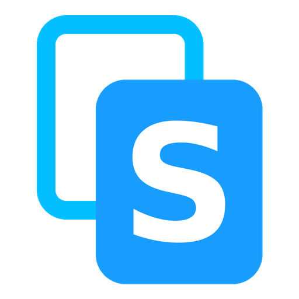

# SCopy



Play, download and delete your recordings, screenshots and videos from any browser on the same Wi-Fi: a PC, a Mac or a phone. It runs on a **Steam Frame** (as a tab in the SteamVR dashboard) and on a **Steam Deck or Steam Machine** (as a Decky Loader plugin in the Quick Access menu). Nothing needs installing on the other device, and nothing needs root.

SCopy used to be called FrameCopy. Installing or updating SCopy replaces FrameCopy and keeps its settings and remembered computers.

It shares:

- recordings from SFRecorder (`~/Videos/SFRecorder`)
- Steam screenshots, named by game
- Steam Game Recording's background recordings and clips, turned into MP4s you can play and download (see below)
- `~/Videos` and `~/Pictures`, one folder level down
- older recordings from [framecorder](https://github.com/coah80/framecorder) (`~/Videos/framecorder`, including `clips`)

The page has a filter for each of these. Steam's own screenshots, recordings and clips can be deleted too, after a warning: Steam keeps its own list of them, so it may show a deleted one as missing until it refreshes.

## Install on a Steam Frame

You can install it straight from the headset. You don't need Desktop Mode.

1. **Turn on Developer Mode:** on the Frame, open **Settings → General** and turn on **Developer Mode** so you can open Konsole.
2. **Open Konsole,** paste this line and press Enter:

```bash
cd ~ && (git clone https://github.com/MWGIH/SCopy.git || git -C SCopy pull) && SCopy/install.sh
```

Running the same line again later updates it.

## Install on a Steam Deck or Steam Machine

SCopy is a [Decky Loader](https://decky.xyz) plugin there. Install Decky Loader first if you haven't already.

**From the URL (easiest):**

1. In Decky's settings, turn on **Developer mode**.
2. Open **Developer**, choose **Install plugin from URL** and paste this address:

```text
https://github.com/MWGIH/SCopy/releases/download/decky-latest/SCopy.zip
```

To update, install from the same URL again.

**If the URL doesn't work, use the zip instead:**

1. Download [SCopy.zip](https://github.com/MWGIH/SCopy/releases/download/decky-latest/SCopy.zip) from the [releases page](https://github.com/MWGIH/SCopy/releases/tag/decky-latest) in the Deck's browser (Desktop Mode), or copy it to the Deck's Downloads folder.
2. In Decky's **Developer** settings, choose **Install plugin from ZIP** and pick `SCopy.zip`. Don't unzip it first.

To build the zip yourself you need Node.js and pnpm: run `decky/build.sh`, which writes `decky/out/SCopy.zip`. GitHub Actions builds it on every push to `main` and publishes it as the `decky-latest` pre-release.

## Use it

On a Steam Frame, open the **SteamVR dashboard** and select the **SCopy** tab. On a Steam Deck or Steam Machine, press the **...** (Quick Access) button and open **SCopy** under the Decky plug icon.

1. Press **Start sharing**. SCopy shows an address and a 4-digit PIN.
2. On your PC or phone, open the address in a browser and enter the PIN. Leave **Remember this computer** ticked and that browser won't ask for the PIN again, even after SCopy restarts.
3. Click a video to play it or a picture to view it, download one, tick several to download them as one zip, or delete them (it asks first).
4. Press **Stop sharing** when you're done. It also stops by itself after 30 minutes without use. On a Steam Frame, press **Auto-stop after 30 min** in the SCopy tab to turn that off, and sharing keeps going until you press **Stop sharing**. SCopy remembers the choice.

Sharing keeps going if you leave VR, until you stop it or it times out.

To make a computer ask for the PIN again, press **Forget this computer** on the page, or **Forget PCs** in SCopy to forget them all. A computer is remembered per address, so the `.local` address and the IP address each ask once.

On the Frame the tab also has **Update**, which downloads the latest SCopy, and **Uninstall** (click twice). On a Deck or Machine, update and uninstall it from Decky. Uninstalling never touches your recordings.

## Settings

To share another recordings folder, use another port or share only the recordings folder, create `~/.config/scopy/config.ini`:

```ini
[scopy]
folder = ~/Videos/SFRecorder
port = 8642
# no = only the recordings folder, not Steam screenshots and clips, Videos, Pictures and framecorder
steamos_folders = yes
```

Then restart SCopy: on the Frame with `systemctl --user restart scopy`, on a Deck or Machine by restarting Decky (or the device).

## Without the app

You can also share from Konsole or over SSH, without SteamVR or Decky:

```bash
python3 ~/SCopy/scopy.py
```

It prints the address and PIN; press Ctrl+C to stop.

## Options for scopy.py

| Option | What it does |
|---|---|
| `--dir FOLDER` | Folder to share (default `~/Videos/SFRecorder`). Subfolders one level down, such as `clips`, are included |
| `--port N` | Port to listen on (default 8642) |
| `--only-dir` | Share only `--dir`, not Steam's screenshots and clips, `~/Videos`, `~/Pictures` and framecorder's folder |
| `--json` | For apps that run SCopy as a child process: prints one line `{"urls": [...], "pin": "1234", "port": 8642}` once listening, logs to stderr, exits 0 when sharing stops (idle, SIGTERM or Ctrl+C), and exits 1 if the port is taken |

## Good to know

- Only videos (`.mp4`, `.mkv`, `.webm`, `.mov`) and pictures (`.jpg`, `.png`, `.webp`) are shown. Recordings still being written (`.part` files) appear once they finish.
- Steam Game Recording saves each recording as many small pieces (`.m4s` chunks). SCopy joins them into one MP4 as you play or download it, without ffmpeg and without using extra space. It finds them in Steam's default folder and in the recording folder chosen in Steam's settings. A recording still being made appears 30 seconds after it stops.
- Video thumbnails need `ffmpeg`. Without it the page still works, it just shows no video previews.
- If the `.local` address doesn't open, use the one with the number (IP address).
- It uses plain HTTP and a PIN, which is fine on your home network. Don't turn it on over public Wi-Fi.

## Using it from another app

A recorder can start and stop sharing itself, for example from a "Share recordings" switch:

```python
from scopy import ShareServer

server = ShareServer("~/Videos/SFRecorder", port=8642, on_stop=switch_off)
server.start()
show(server.urls, server.pin)   # server.urls: [".local" address, IP address]
...
server.stop()
```

`on_stop` is called when sharing stops by itself after 30 minutes idle.
